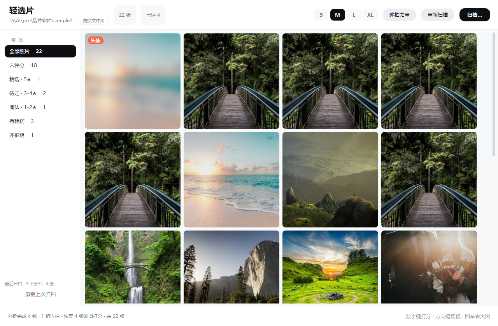
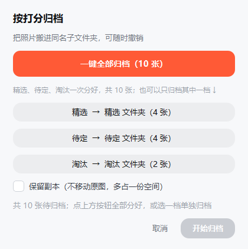
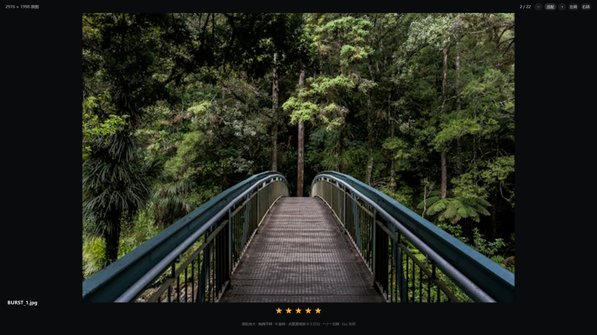
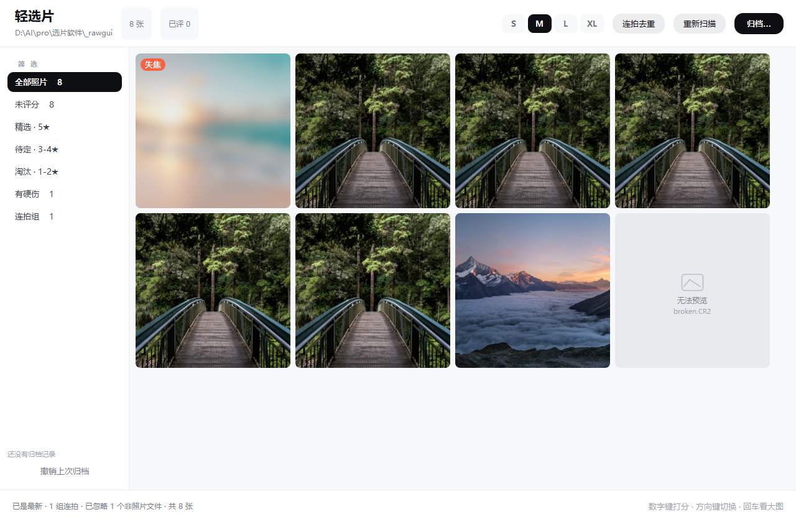
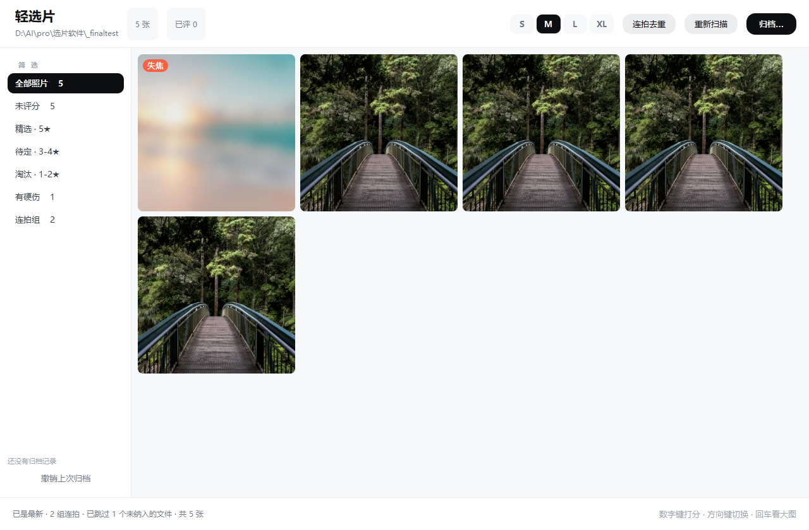
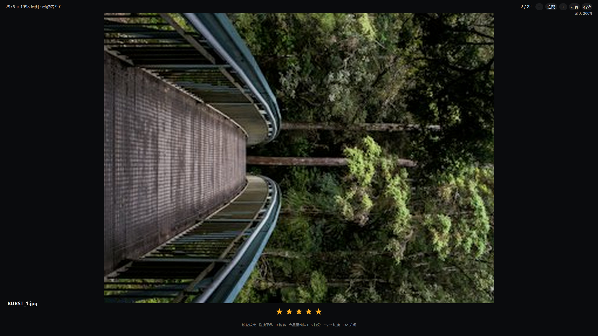

# 选片助手

本地选片工具：打开一个文件夹，用 1–5 星打分，把照片分流进「精选 / 待定 / 淘汰」三个子文件夹。
照片始终留在你自己的硬盘上，不上传、不联网、不需要注册账号。

参考了 [enter-cat/easyphoto](https://github.com/enter-cat/easyphoto)（客户端形态与归档流程）和
[Ray25010/Frame-Cull-AI](https://github.com/Ray25010/Frame-Cull-AI)（硬伤门禁的取舍思路），
界面沿用《产品实现文档》§4.8 的设计语言。

---

## 快速开始

```bat
:: 直接跑源码（不打包、不生成 exe）
python app.py "D:\照片\婚礼"

:: 或者双击 启动轻选片.bat
```

启动器会自己找 Python（先找本机自带的运行时，再找 PATH，最后扫 `%LOCALAPPDATA%\Programs\Python` 等常见位置）；
依赖没装齐时不会一闪而过，而是弹窗告诉你缺哪个、该敲哪条命令。

> 批处理文件必须是 **纯 ASCII + CRLF 行尾**：只要里面写了中文（编码和控制台代码页不一致），
> cmd 会把后面的命令整体解析错位，报出 `'art' 不是内部或外部命令` 这种莫名错误。
> 所以中文提示都放在 `launch.pyw` 里，用系统弹窗显示。

不给路径也行，启动后按 `Ctrl+O` 选文件夹（也可以点右上角「打开文件夹」）。

---

## 界面

| | |
|---|---|
|  |  |
| 照片墙：S/M/L/XL 四档密度，右下角星级，左上角硬伤标；顶栏可换文件夹，状态栏提示恢复了旧打分 | 归档确认：按分档批量搬走，可勾「保留副本」 |
|  |  |
| 全屏看图：`←/→` 翻页，`1–5` 打分，底部图标工具条 | RAW 支持：6 种相机 RAW 直接读内嵌预览；读不出的显示「无法预览」仍可打分 |
|  |  |
| 子目录 + RAW 混合：多层文件夹一起扫，状态栏说明跳过了什么 | 看图缩放 + 旋转：底部图标工具条，滚轮放大到 800%，`R` 转 90° |

---

## 它做什么

| 能力 | 说明 |
| --- | --- |
| **四档缩略图** | 顶栏 `S / M / L / XL` 切换 5/4/3/2 列，窗口拉大自动重排 |
| **星级打分** | 选中照片按 `1`–`5` 打分，**最低 1 星、最高 5 星**；打分区段自动映射 5★ 精选 / 3–4★ 待定 / 1–2★ 淘汰 |
| **按分归档** | `Ctrl+F` 打开归档对话框：**一键全部归档**把精选/待定/淘汰一次分好（只写一条记录，撤销也一起回来），也能只归档其中一档；重名自动加 `(1)(2)`，**绝不覆盖** |
| **换文件夹** | 顶栏的文件夹路径可以直接点，右边还有「更换文件夹」（`Ctrl+O`）——选错了随时换 |
| **打分记得住** | 归档后照片被搬进 `精选/`、`待定/` 等子文件夹，再选同一个文件夹时按「文件名+大小+修改时间」把旧分数接回来，状态栏会提示「恢复 N 张的旧打分」 |
| **一键撤销** | `Ctrl+Z` 撤销上一次归档，文件搬回原位 |
| **硬伤预筛** | 失焦（拉普拉斯方差）、过曝/欠曝（直方图占比）、分辨率过低，只标记不自动淘汰 |
| **全屏看图** | `回车` 或空格进大图，`←/→` 翻页，`1`–`5` 打分；照片**底部中间**有一排图标按钮（缩小 / 放大 / 适配 / 左转 / 右转），也支持滚轮放大、拖拽平移、`R`/`⇧R` 旋转、`F` 适配窗口，按原图分辨率解码 |
| **进度可见** | 状态栏显示扫描/分析进度条，分析在后台线程跑，界面不卡 |

键盘一览：`Ctrl+O` 打开 · `F5` 重新扫描 · `Ctrl+F` 归档 · `Ctrl+Z` 撤销 ·
`1–5` 打分 · `回车/空格` 看图 · `←/→` 在网格里移动选中。

看大图时：**图片底部中间的图标工具条**（缩小 / 放大 / 适配窗口 / 向左旋转 / 向右旋转，放大时右侧显示百分比）·
`滚轮` 缩放（以光标为中心）· `+ / -` 缩放 · `F` 适配窗口 · `R` / `⇧R` 旋转 90° ·
拖拽平移 · `Esc` 先退出放大、再按一次关闭。

---

## 数据存在哪

打开一个文件夹后，会在**该文件夹内**生成两个隐藏目录。如果这个文件夹写不进去（只读盘、网络盘、权限不足），
程序会自动改用 `%LOCALAPPDATA%\轻选片\libraries\<目录名>-<哈希>\`，状态栏提示一句，功能不受影响。

删掉这两个隐藏目录等于清空打分记录，照片本身不受影响：

```
你的照片文件夹/
├── .xuanpian.db        # SQLite：打分、硬伤标记、打分记忆、归档日志
├── .xuanpian-cache/    # 缩略图缓存，删掉会自动重建
├── 精选/ 待定/ 淘汰/    # 归档后生成
└── *.jpg
```

数据库按**相对路径**记录照片，所以整个文件夹搬走后，打分依然对得上。

---

## 目录结构

```
选片软件/
├── app.py                 # 入口，含 --shot 截图自检参数
├── core/
│   ├── const.py           # 阈值、分档、硬伤位掩码
│   ├── scanner.py         # 递归扫描图片
│   ├── analyze.py         # 清晰度 / 曝光 / 指纹 / EXIF
│   ├── store.py           # SQLite 读写
│   ├── archive.py         # 归档与撤销
│   ├── thumbs.py          # 缩略图磁盘缓存
│   └── project.py         # 门面，UI 只依赖这一层
├── ui/
│   ├── theme.py           # 设计 token + QSS
│   ├── workers.py         # QThreadPool 任务封装
│   ├── photo_model.py     # 模型 + 自绘 delegate
│   ├── grid.py            # 网格视图
│   ├── viewer.py          # 全屏看图
│   └── main_window.py     # 主窗口 + 归档对话框
├── tools/
│   ├── make_samples.py    # 生成测试样片（含过曝/欠曝/失焦）
│   ├── smoke.py           # 核心层冒烟测试
│   └── ui_test.py         # 界面交互自检（离屏）
└── sample2/               # 22 张样片，可以直接拿来试
```

---

## 阈值想改怎么办

都在 `core/const.py`：

```python
SHARP_BLUR_MAX = 60.0      # 拉普拉斯方差低于它 → 判定失焦
OVEREXPOSED_RATIO = 0.08   # 高光（≥250）像素占比超过 8% → 过曝
UNDEREXPOSED_RATIO = 0.12  # 暗部（≤5）像素占比超过 12% → 暗部丢失
MIN_MEGAPIXEL = 1.0        # 低于 100 万像素 → 分辨率低
```

嫌误报多就把 `SHARP_BLUR_MAX` 调小，嫌漏报多就调大。硬伤只是**角标提示**，不会替你删照片。

---

## 自检

```bat
python tools/smoke.py      :: 核心层：扫描 / 分析 / 归档 / 撤销（6 项）
python tools/ui_test.py    :: 界面层 26 项交互（离屏，不弹窗）：含一键全部归档、星级上下限、看图缩放与旋转
python tools/edge_test.py  :: 边界 16 项：空目录 / 坏图 / 重名归档 / 外部删文件 / RAW / 一键全部归档 / 重新打开恢复打分
```

两个脚本都会打印 `✓ / ✗`，最后一行是汇总。

---

## 支持的格式

| 类别 | 扩展名 | 说明 |
| --- | --- | --- |
| 常见位图 | `.jpg` `.jpeg` `.png` `.webp` `.bmp` `.tif` `.tiff` | 直接解码 |
| iPhone | `.heic` `.heif` | 装 `pillow-heif` 后直接解码；没装则尝试内嵌预览 |
| 相机 RAW | `.cr2` `.cr3` `.nef` `.nrw` `.arw` `.raf` `.rw2` `.orf` `.pef` `.dng` `.srw` `.3fr` `.iiq` `.x3f` … | 不解 RAW 本身，读它**内嵌的全尺寸 JPEG 预览**——选片够用，也不用装 libraw |

读不出画面的文件（损坏、缺内嵌预览）不会消失：网格里仍占一格，显示「无法预览」+ 文件名，照样能打分、能归档。

扫描时会统计没被当成照片的文件（例如 `.txt`、`.psd`），状态栏显示「已忽略 N 个非照片文件」，悬停可看扩展名明细，同时写进 `app.log`——再遇到"照片没全部读出来"，先看这一行。

---

## 还没做的

- 人脸/闭眼检测（要模型文件，暂时不做）
- 分享给客户选片的协作模式（那是 easyphoto 的 H5 交付页，本地版不需要）
